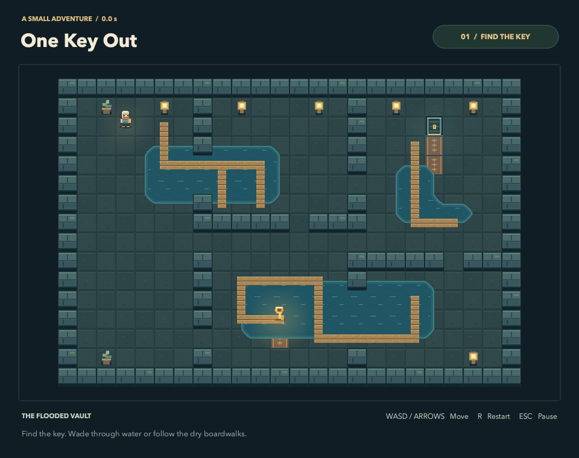

# One Key Out

작은 금고에서 황금 열쇠를 찾아 출구로 나가는 macOS 탑다운 게임입니다.
한 맵에서 이동, 벽 충돌, 열쇠 획득, 클리어, 일시정지와 재시작까지 플레이할 수 있습니다.
현재 버전에는 적, 사운드, 세이브가 없습니다.



## 시작

Tiled 저장소 루트에서 실행합니다.

```sh
./onekeyout/run.sh
./onekeyout/run.sh --build-only
./onekeyout/run.sh --check
./onekeyout/run.sh --package
```

`run.sh`는 다른 작업 디렉터리에서도 자신의 위치를 찾아 실행합니다. 사용자 지정
게임 인자 앞에는 `--`를 넣습니다. 상대 파일 경로는 명령을 실행한 디렉터리 기준입니다.

```sh
./onekeyout/run.sh -- --map onekeyout/assets/maps/first-room.tmx
./onekeyout/run.sh -- --capture onekeyout/build/start.png --quit-after 600
```

| 입력 | 동작 |
| --- | --- |
| 방향키 / WASD | 이동 |
| R | 현재 방 처음부터 다시 시작 |
| Esc | 일시정지 / 계속 |
| Enter / Space | 일시정지 해제 또는 클리어 후 재시작 |
| 화면의 Continue / Play Again | 클릭으로 계속 / 재시작 |

앱에서 다른 창으로 전환하면 자동으로 일시정지하고 눌린 키를 해제합니다.
돌아온 뒤 Esc 또는 Continue로 계속합니다.

## 준비와 빌드

기존 Tiled 프로젝트를 참조하므로 루트 `README.md`의 Qt/Qbs 개발 환경을 사용합니다.
macOS에는 Xcode Command Line Tools와 Python 3.9 이상도 필요합니다.

```sh
brew install qbs qttools
```

2026-10-22에 로컬 Qbs 3.3.1, Qt 6.12.0, Apple Clang 21, arm64 환경에서 구현했습니다.
게임 언어 표준은 기존 `libtiled`와 같은 C++17입니다. Qt 최소 조건은 기존 라이브러리와
같은 6.2이며, 실제 검증 조합과 최소 조건은 구분합니다. Tiled 소스와 버전은 이 checkout의
것을 사용하며, 별도 복사본이나 패치를 만들지 않습니다.

개발 빌드는 `build/debug/bin/One Key Out.app`에 생성됩니다. 이 앱은 Qbs 개발 환경의
라이브러리 경로를 사용하므로 개발 중에는 `run.sh`로 실행합니다. `--check`는 게임과
테스트 타깃을 빌드하고, 최대 45초 동안 offscreen Qt 검사를 실행합니다.
검사 화면은 `build/evidence/`에 생성합니다.

## VS Code 코드 분석

VS Code에서 Tiled 저장소 루트 또는 `onekeyout/`을 열고 clangd 확장을 사용합니다.
처음 체크아웃했거나 `build/`를 지웠다면 `./onekeyout/run.sh --build-only`를 실행합니다.
테스트 코드를 편집할 때는 `./onekeyout/run.sh --check`로 테스트의 Qt 생성 헤더도 준비합니다.
`run.sh`는 매 빌드 후 Qbs의 실제 컴파일 옵션으로
`onekeyout/build/debug/compile_commands.json`을 생성·갱신합니다.
`onekeyout/.clangd`가 이 파일을 가리키므로 Qt 헤더·프레임워크 경로, C++17,
전처리 정의와 생성 헤더 경로를 같은 빌드 설정에서 가져옵니다.
Qt 설치 경로를 편집기 설정에 직접 적을 필요는 없습니다.

열려 있던 파일에 이전 진단이 남으면 명령 팔레트에서 **clangd: Restart language server**를
한 번 실행합니다. 설정은 `onekeyout/` 아래 코드에 적용되며 원본 Tiled의 IDE 설정은
수정하지 않습니다. 생성한 컴파일 데이터베이스는 `build/` 안에 두고 Git에서 제외합니다.

참고: [Qbs clangdb 생성](https://doc.qt.io/qbs/generators.html#generating-clang-compilation-databases),
[clangd 프로젝트 설정](https://clangd.llvm.org/config.html#compilationdatabase).

## Tiled에서 편집

`onekeyout.tiled-project`를 열고 `assets/maps/first-room.tmx`를 편집합니다.
프로젝트의 **Play One Key Out** 명령은 현재 맵을 저장한 뒤 게임으로 실행합니다.
터미널의 기본 `run.sh`도 이 디스크 맵을 읽으므로 편집 후 다시 실행하면 반영됩니다.
배포 앱의 기본 맵은 빌드에 포함된 Qt 리소스입니다.

| 항목 | 지원 규약 |
| --- | --- |
| 맵 | 유한 직교 맵, 32×32 px 타일, 가로·세로 각각 3–64칸 |
| Ground | 맵 크기와 같은 바닥 타일 레이어 |
| Walls | 타일이 있는 모든 칸이 벽인 타일 레이어 |
| Objects | 아래 세 클래스의 오브젝트를 하나씩 배치 |
| Foreground | 선택 사항. 캐릭터보다 앞에 그리는 타일 레이어 |
| PlayerSpawn | 플레이어 중심을 나타내는 point 오브젝트 |
| Key | 획득 영역을 나타내는 rectangle 오브젝트 |
| Exit | 클리어 영역을 나타내는 rectangle 오브젝트 |
| title | 선택 사항. 맵의 문자열 속성, 화면 하단 방 이름 |

레이어는 최상위에 두고 표시 상태, 불투명도 1, 위치·오프셋 0을 유지합니다.
그룹·이미지 레이어, 무한 맵, 회전 오브젝트, tile object는 지원하지 않습니다.
타일셋은 32 px 타일의 atlas 이미지 형식입니다. 런타임 타일 애니메이션은 구현하지 않았습니다.
통로는 셀 단위로 연결하며, 스폰·열쇠·출구는 벽과 겹치지 않는 셀 중심에 놓는 것을 권장합니다.
세 오브젝트가 겹치거나 목표까지 길이 없으면 로더가 오류를 보고합니다.

타일셋·이미지는 상대경로로 참조합니다. `.tiled-project`는 Git으로 관리하고,
개인 편집 상태인 `.tiled-session`은 제외합니다. `tools/create-assets.py`는 초기 자작
이미지와 맵을 만들었던 레시피이며, 기존 저작 파일이 있으면 덮어쓰기를 거부합니다.
일상적인 맵 편집에는 생성기를 다시 실행하지 않습니다.

## 구조와 upstream 경계

```text
workspace.qbs       기존 ../tiled.qbs와 게임·테스트를 연결하는 진입점
onekeyout.qbs       게임 타깃
src/               게임 코드
assets/            편집 가능한 TMX·TSX·PNG
assets.qrc         같은 자산을 배포 앱에 포함하는 리소스 목록
tests/             규칙·맵 로딩·키 입력·화면 상태 검사
tools/             실행·패키징·초기 자작 자산 도구
build/             개발 산출물과 검증 화면, Git 제외
dist/              배포 앱, Git 제외
```

기존 루트 `tiled.qbs`, `src/libtiled`, `qbs`, `examples`, `tests`를 수정하지 않습니다.
`workspace.qbs`가 원본 프로젝트를 참조하고 게임 타깃이 `libtiled`에 의존합니다.
Qbs는 프로젝트 전체 구성을 읽지만, `run.sh`는 게임과 필요한 의존성만 빌드합니다.
upstream API 변경에 따른 호환성 수정은 이 폴더의 연결 코드에서 처리합니다.

`LevelLoader`는 기존 `Tiled::MapReader`로 TMX·TSX를 읽고 게임 규약을 검증합니다.
`GameWorld`는 Qt Core 값 타입만 사용하여 위치·충돌·열쇠·승패를 계산합니다.
`GameView`는 기존 `Tiled::MapRenderer`로 타일을 그리고 자작 캐릭터와 효과를 표시합니다.
`GameWindow`는 키 입력, 60 Hz 고정 시뮬레이션, 창과 HUD를 소유합니다.
최대 0.1초의 catch-up과 작은 충돌 이동 단계를 적용합니다.

## macOS 앱 패키징

`--package`는 빌드된 앱을 별도 staging 폴더에 복사하고 `libtiled`, Qt 및 필요한
동적 라이브러리를 포함합니다. 시스템 외부의 절대 라이브러리 참조를 검사하고,
임시 서명과 embedded 맵 검증이 성공하면 `dist/One Key Out.app`을 교체합니다.
원본 개발 앱은 수정하지 않습니다. 기본 맵과 이미지는 실행 파일의 Qt 리소스에 포함되어
원본 저장소 없이도 로드됩니다.

```sh
open "onekeyout/dist/One Key Out.app"
```

현재 패키지는 로컬 개발용 ad-hoc 서명입니다. 다른 사용자에게 정식 배포하려면
Developer ID 서명·공증과 배포 의존성의 라이선스 준비가 별도로 필요합니다.
의존성과 자작 자산의 출처는 `THIRD_PARTY.md`를 참고하세요.

## 검증 범위

자동 검사는 TMX와 embedded 맵의 주요 데이터 동등성, 잘못된 맵 거부,
벽 충돌, 대각선 속도, 긴 프레임 처리, 잠긴 출구, 열쇠 획득, 승리 후 정지,
재시작 초기화, 일시정지와 앱 비활성화 시 입력 해제를 확인합니다.
키 이벤트로 실제 맵을 시작점부터 열쇠와 출구까지 이동하며 화면을 캡처합니다.
offscreen 검사는 실제 macOS 포커스·입력·Retina 표시 확인을 대체하지 않습니다.

2026-10-22 검증 결과: 자동 검사 13개 통과, 시작·일시정지·열쇠 획득·클리어·최소 창 크기
캡처 확인, 임시 폴더로 복사한 앱의 Cocoa 실행과 1920×1520 Retina 캡처 확인,
런타임 라이브러리 로그의 Homebrew·개발 저장소 경로 0건, 코드 서명 검사 통과.
Computer Use의 native pipe 시작 실패로 OS 키 입력은 직접 검증하지 못했습니다.
키 이벤트 기반 플레이와 앱 비활성화 처리는 Qt 자동 검사로 확인했습니다.
